# 基于Hadoop的高校固定资产管理系统研究与实现hot14

> 🎓 **计算机毕业设计 · 基于Hadoop的高校固定资产管理系统研究与实现hot14**
>
> 本仓库只放**项目介绍 + 运行截图**（截图是站点带水印的原图，存在仓库 `images/` 里）。
>
> 👉 **完整可运行源码 / 数据库脚本 / 部署文档：[点我获取](https://geekcode.top/archives/%E5%9F%BA%E4%BA%8EHadoop%E7%9A%84%E9%AB%98%E6%A0%A1%E5%9B%BA%E5%AE%9A%E8%B5%84%E4%BA%A7%E7%AE%A1%E7%90%86%E7%B3%BB%E7%BB%9F%E7%A0%94%E7%A9%B6%E4%B8%8E%E5%AE%9E%E7%8E%B0hot14?utm_source=github)**
>
> 💬 咨询微信：**ir9372**　|　🌐 更多项目：[极客代码 geekcode.top](https://geekcode.top/?utm_source=github)
>
> 📌 项目详情页：<https://geekcode.top/archives/%E5%9F%BA%E4%BA%8EHadoop%E7%9A%84%E9%AB%98%E6%A0%A1%E5%9B%BA%E5%AE%9A%E8%B5%84%E4%BA%A7%E7%AE%A1%E7%90%86%E7%B3%BB%E7%BB%9F%E7%A0%94%E7%A9%B6%E4%B8%8E%E5%AE%9E%E7%8E%B0hot14?utm_source=github>

<table><td width="230" align="center"> <b>扫码加微信 ir9372</b></td><td valign="middle">📦 源码 = 项目介绍 + 全部运行截图 + 数据库 + 部署文档 👉 点上方任意截图，直接跳到 <b>极客代码 geekcode.top</b> 详情页</td></table>

---

<h1>基于Hadoop的高校固定资产管理系统研究与实现_hot14</h1>
<h2>项目概述</h2>

本项目旨在构建一个基于 Hadoop 生态理念的高校固定资产管理系统，核心目标是实现高校内部资产全生命周期的数字化管理。系统主要面向高校行政管理人员、后勤部门及普通师生用户，解决传统手工台账效率低、数据不透明、资产流失难追溯等痛点。技术架构采用前后端分离模式，后端基于 Spring Boot 框架结合 MyBatis-Plus 进行持久层开发，利用 Shiro 实现权限控制；前端采用 Vue 框架构建单页应用。系统涵盖资产从采购、入库、分类、领用、借用、调拨、维修、盘点到报废的完整业务流程，确保资产数据的准确性与实时性，提升高校资产管理水平。

<h2>技术架构</h2>

本系统采用成熟的前后端分离架构设计，以确保系统的可维护性与扩展性。

<strong>1. 后端架构</strong>

<ul>
<li><strong>核心框架</strong>：使用 Spring Boot 作为基础框架，提供自动配置和快速开发能力。</li>
<li><strong>持久层</strong>：集成 MyBatis-Plus 简化数据库操作，支持 CRUD 自动生成及条件构造器，提高开发效率。</li>
<li><strong>安全模块</strong>：引入 Apache Shiro 进行身份认证与授权管理，保障系统访问安全。</li>
<li><strong>数据库交互</strong>：通过 mysql-connector-java 连接 MySQL 数据库，利用 spring-boot-starter-jdbc 管理数据源事务。</li>
</ul>

<strong>2. 前端架构</strong>

<ul>
<li><strong>视图层</strong>：基于 Vue.js 构建用户界面，通过路由（Router）管理后台各功能模块页面的切换。</li>
<li><strong>通信机制</strong>：前端通过 HTTP 请求与后端 Controller 接口进行数据交互，实现异步加载与动态渲染。</li>
</ul>

<strong>3. 核心技术选型理由</strong>

<ul>
<li><strong>Spring Boot + MyBatis-Plus</strong>：组合具备高性能、易配置的特点，适合处理复杂的业务逻辑和数据查询需求。</li>
<li><strong>Shiro</strong>：轻量级且功能强大，能够灵活控制不同角色对特定资源（如 <code>/zichancaigou</code>, <code>/gudingzichan</code> 等路径）的访问权限。</li>
<li><strong>MySQL</strong>：作为主流关系型数据库，稳定可靠，适合存储结构化的资产信息、员工信息及流转记录。</li>
</ul>
<h2>功能模块</h2>

根据提供的路由列表及截图信息，本系统仅包含后台管理端功能，无前台用户独立入口。所有功能均通过后台路由进行访问和管理。

<h3>后台管理端功能模块</h3>
<table>
<thead>
<tr>
<th align="left">模块名称</th>
<th align="left">对应路由/Controller</th>
<th align="left">功能描述</th>
</tr>
</thead>
<tbody><tr>
<td align="left"><strong>登录认证</strong></td>
<td align="left"><code>/login</code> (隐含)</td>
<td align="left">管理员输入账号密码进行身份验证，进入系统首页。</td>
</tr>
<tr>
<td align="left"><strong>首页概览</strong></td>
<td align="left"><code>/index</code> (隐含)</td>
<td align="left">展示系统关键数据统计或快捷入口，反映资产总体状况。</td>
</tr>
<tr>
<td align="left"><strong>员工管理</strong></td>
<td align="left"><code>/yuangong</code>, <code>YuangongController</code></td>
<td align="left">维护学校教职工基本信息，包括姓名、部门、联系方式等，用于关联资产责任人。</td>
</tr>
<tr>
<td align="left"><strong>学生管理</strong></td>
<td align="left"><code>/xuesheng</code>, <code>XueshengController</code></td>
<td align="left">维护在校学生基本信息，用于处理涉及学生的资产借用或领用场景。</td>
</tr>
<tr>
<td align="left"><strong>固定资产档案</strong></td>
<td align="left"><code>/gudingzichan</code>, <code>GudingzichanController</code></td>
<td align="left">建立资产主数据档案，记录资产编号、名称、规格、原值、购置日期等核心属性。</td>
</tr>
<tr>
<td align="left"><strong>资产分类</strong></td>
<td align="left"><code>/zichanfenlei</code></td>
<td align="left">定义资产的类别体系（如电子设备、办公家具等），便于统计检索与管理。</td>
</tr>
<tr>
<td align="left"><strong>采购管理</strong></td>
<td align="left"><code>/caigou</code>, <code>CaigouController</code></td>
<td align="left">记录资产采购计划、供应商信息及采购订单详情。</td>
</tr>
<tr>
<td align="left"><strong>资产采购</strong></td>
<td align="left"><code>/zichancaigou</code></td>
<td align="left">具体执行采购流程，生成采购单据，可能涉及审批环节。</td>
</tr>
<tr>
<td align="left"><strong>资产入库</strong></td>
<td align="left"><code>/zichanruku</code></td>
<td align="left">新购资产验收入库，更新库存状态，生成入库单。</td>
</tr>
<tr>
<td align="left"><strong>领用管理</strong></td>
<td align="left"><code>/lingyongxinxi</code>, <code>LingyongxinxiController</code></td>
<td align="left">处理个人或部门从仓库领取资产的业务，记录领用人、时间及用途。</td>
</tr>
<tr>
<td align="left"><strong>借用管理</strong></td>
<td align="left"><code>/jieyongxinxi</code>, <code>JieyongxinxiController</code></td>
<td align="left">处理临时借用资产的业务，记录借用人、预计归还时间，支持归还操作。</td>
</tr>
<tr>
<td align="left"><strong>资产调拨</strong></td>
<td align="left"><code>/zichandiaobo</code></td>
<td align="left">实现资产在不同部门或校区之间的转移调配，更新资产归属地。</td>
</tr>
<tr>
<td align="left"><strong>资产报修</strong></td>
<td align="left"><code>/zichanbaoxiu</code>, <code>ZichanbaoxiuController</code></td>
<td align="left">接收资产故障报告，生成维修工单，跟踪维修进度。</td>
</tr>
<tr>
<td align="left"><strong>资产维修</strong></td>
<td align="left"><code>/zichanweixiu</code></td>
<td align="left">记录实际维修过程、更换配件及费用，完成维修闭环。</td>
</tr>
<tr>
<td align="left"><strong>资产维护</strong></td>
<td align="left"><code>/zichanweihu</code></td>
<td align="left">针对定期保养、巡检等非故障类维护活动进行记录。</td>
</tr>
<tr>
<td align="left"><strong>资产盘点</strong></td>
<td align="left"><code>/zichanpandian</code></td>
<td align="left">发起实物盘点任务，对比账面数量与实际数量，生成盘盈盘亏报告。</td>
</tr>
<tr>
<td align="left"><strong>资产报废</strong></td>
<td align="left"><code>/zichanbaofei</code>, <code>ZichanbaofeiController</code></td>
<td align="left">处理达到使用年限或损坏无法修复资产的报废申请与注销登记。</td>
</tr>
<tr>
<td align="left"><strong>通用配置</strong></td>
<td align="left"><code>ConfigController</code>, <code>CommonController</code></td>
<td align="left">管理系统参数、字典数据及通用业务逻辑支持。</td>
</tr>
<tr>
<td align="left"><strong>文件服务</strong></td>
<td align="left"><code>FileController</code></td>
<td align="left">处理用户上传的附件，如资产照片、发票扫描件、维修单据等。</td>
</tr>
</tbody></table>
<h2>用户角色与权限</h2>

基于 Shiro 框架及现有代码上下文，系统主要划分为以下角色，不同角色拥有不同的菜单访问权限：

<strong>1. 超级管理员 (Admin)</strong>

<ul>
<li><strong>权限范围</strong>：拥有系统最高权限，可访问所有后台路由模块。</li>
<li><strong>具体功能</strong>：</li>
<li><strong>人员管理</strong>：编辑员工 (<code>/yuangong</code>) 和学生 (<code>/xuesheng</code>) 信息。</li>
<li><strong>资产全生命周期管理</strong>：</li>
<li>基础数据：管理固定资产 (<code>/gudingzichan</code>)、资产分类 (<code>/zichanfenlei</code>)。</li>
<li>流入环节：处理采购 (<code>/caigou</code>, <code>/zichancaigou</code>) 和入库 (<code>/zichanruku</code>)。</li>
<li>使用环节：审批领用 (<code>/lingyongxinxi</code>) 和借用 (<code>/jieyongxinxi</code>)，执行调拨 (<code>/zichandiaobo</code>)。</li>
<li>维护环节：管理报修 (<code>/zichanbaoxiu</code>)、维修 (<code>/zichanweixiu</code>) 和维护 (<code>/zichanweihu</code>)。</li>
<li>退出环节：执行盘点 (<code>/zichanpandian</code>) 和报废 (<code>/zichanbaofei</code>)。</li>
<li><strong>系统设置</strong>：修改系统配置 (<code>ConfigController</code>)，上传/下载文件 (<code>FileController</code>)。</li>
</ul>

<strong>2. 普通用户/教师/学生 (推测角色)</strong>

<ul>
<li><strong>说明</strong>：虽然路由中未明确区分前台用户端，但存在 <code>XueshengController</code> 和 <code>YuangongController</code>，暗示系统可能允许特定非管理员角色登录或通过特定入口查看与其相关的资产信息。</li>
<li><strong>受限权限</strong>：根据“是否有前台: 否”的配置，当前版本主要聚焦于后台管理视角。若存在细分角色，通常只能查看自己名下领用或借用的资产，以及提交报修申请，无法执行入库、报废、调拨等核心管理操作。具体细粒度按钮权限需依据 Shiro 注解进一步确认，目前可见功能均集中在管理侧。</li>
</ul>
<h2>项目特色与创新点</h2>
<ol>
<li><strong>全流程闭环管理</strong>：系统覆盖了固定资产从“生”（采购、入库）到“死”（报废）的每一个关键节点，并通过“调拨”、“领用”、“借用”等中间态管理，实现了资产状态的实时追踪，避免了账实不符的问题。</li>
<li><strong>多维度的资产流转监控</strong>：不仅支持常规的领用归还，还特别设计了“借用”与“调拨”模块，适应了高校内部跨部门协作频繁、设备共享使用的复杂场景。</li>
<li><strong>完善的售后与维护体系</strong>：将“报修”、“维修”、“维护”分离为独立模块，既记录了故障发生时的申报信息，也保留了实际维修的技术细节和定期保养记录，有助于分析资产质量和使用成本。</li>
<li><strong>基于 Shiro 的安全架构</strong>：引入了成熟的 Apache Shiro 框架，确保了敏感数据（如采购金额、员工隐私）的访问安全性，支持灵活的权限拦截机制。</li>
</ol>
<h2>部署环境</h2>

为确保系统正常运行，需准备以下软件环境：

<ol>
<li><strong>开发/运行环境</strong>：</li>
</ol>
<ul>
<li><strong>JDK</strong>: Java Development Kit 1.8 或更高版本（推荐 JDK 8）。</li>
<li><strong>Maven</strong>: 用于依赖管理和项目构建（版本 3.6+）。</li>
<li><strong>Node.js</strong>: 用于前端 Vue 项目的依赖安装与编译打包（推荐 LTS 版本，如 Node.js 14+）。</li>
</ul>
<ol start="2">
<li><strong>数据库环境</strong>：</li>
</ol>
<ul>
<li><strong>MySQL</strong>: 版本 5.7 或 8.0，需初始化相关表结构以支持 MyBatis-Plus 映射。</li>
</ul>
<ol start="3">
<li><strong>Web 服务器</strong>：</li>
</ol>
<ul>
<li><strong>Tomcat</strong>: Spring Boot 内置 Tomcat，无需单独安装外部容器，直接启动 Jar 包即可。</li>
<li><strong>Nginx</strong> (可选): 用于生产环境下静态资源（Vue 编译后的 dist 文件夹）的反向代理与负载均衡。</li>
</ul>
<ol start="4">
<li><strong>其他依赖</strong>：</li>
</ol>
<ul>
<li><strong>Protobuf</strong>: 代码依赖中包含 <code>protobuf-java</code>，需确保运行时环境兼容相关序列化协议。</li>
<li><strong>Commons Lang3</strong>: 工具类库，随 Maven 依赖自动引入。</li>
</ul>
<h2>五、技术特性</h2>
<ul>
<li>前后端集成部署，前端资源打包至后端 static 目录</li>
<li>使用 MyBatis-Plus 简化数据访问层开发</li>
<li>集成 Shiro 权限框架实现角色权限控制</li>
</ul>
<h2>六、功能模块截图</h2>
<h3>后台管理端</h3>
<h4>后台-采购</h4>

<a href="https://geekcode.top/archives/%E5%9F%BA%E4%BA%8EHadoop%E7%9A%84%E9%AB%98%E6%A0%A1%E5%9B%BA%E5%AE%9A%E8%B5%84%E4%BA%A7%E7%AE%A1%E7%90%86%E7%B3%BB%E7%BB%9F%E7%A0%94%E7%A9%B6%E4%B8%8E%E5%AE%9E%E7%8E%B0hot14?utm_source=github" title="查看完整源码">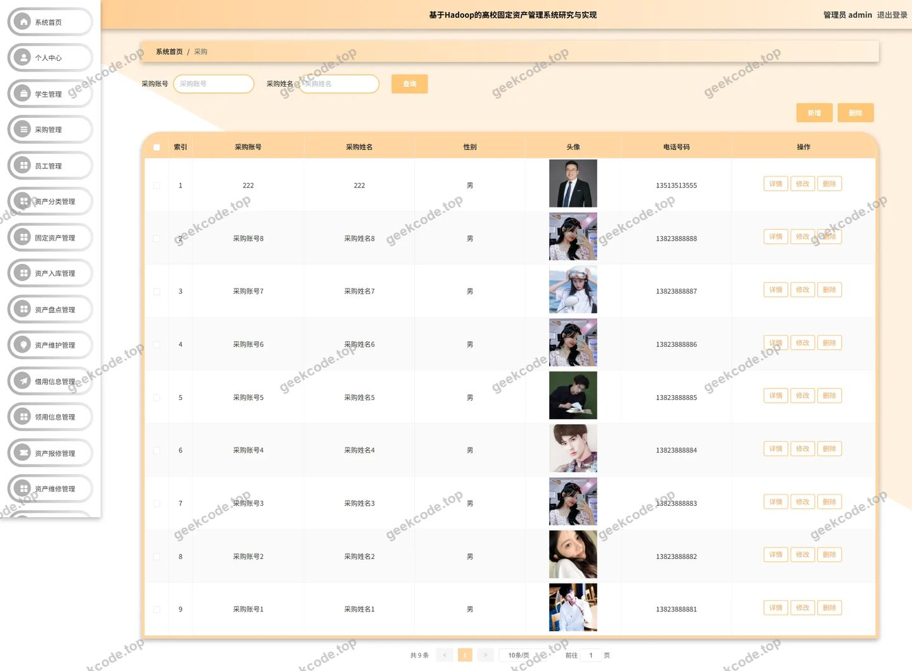</a>

<h4>后台-固定资产</h4>

<h4>后台首页</h4>

<a href="https://geekcode.top/archives/%E5%9F%BA%E4%BA%8EHadoop%E7%9A%84%E9%AB%98%E6%A0%A1%E5%9B%BA%E5%AE%9A%E8%B5%84%E4%BA%A7%E7%AE%A1%E7%90%86%E7%B3%BB%E7%BB%9F%E7%A0%94%E7%A9%B6%E4%B8%8E%E5%AE%9E%E7%8E%B0hot14?utm_source=github" title="查看完整源码">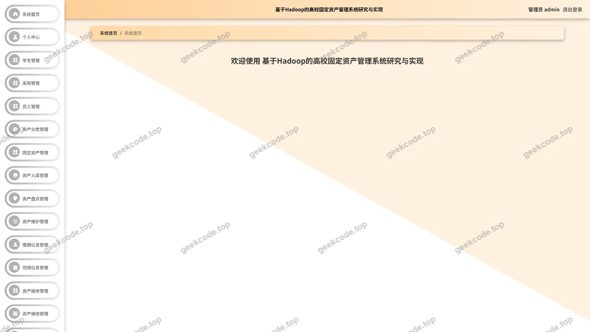</a>

<h4>后台-借用信息</h4>

<a href="https://geekcode.top/archives/%E5%9F%BA%E4%BA%8EHadoop%E7%9A%84%E9%AB%98%E6%A0%A1%E5%9B%BA%E5%AE%9A%E8%B5%84%E4%BA%A7%E7%AE%A1%E7%90%86%E7%B3%BB%E7%BB%9F%E7%A0%94%E7%A9%B6%E4%B8%8E%E5%AE%9E%E7%8E%B0hot14?utm_source=github" title="查看完整源码">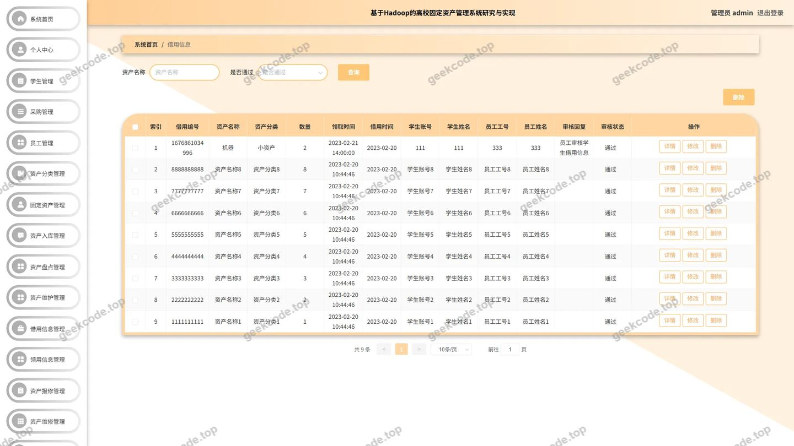</a>

<h4>后台-领用信息</h4>

<h4>后台-登录</h4>

<a href="https://geekcode.top/archives/%E5%9F%BA%E4%BA%8EHadoop%E7%9A%84%E9%AB%98%E6%A0%A1%E5%9B%BA%E5%AE%9A%E8%B5%84%E4%BA%A7%E7%AE%A1%E7%90%86%E7%B3%BB%E7%BB%9F%E7%A0%94%E7%A9%B6%E4%B8%8E%E5%AE%9E%E7%8E%B0hot14?utm_source=github" title="查看完整源码">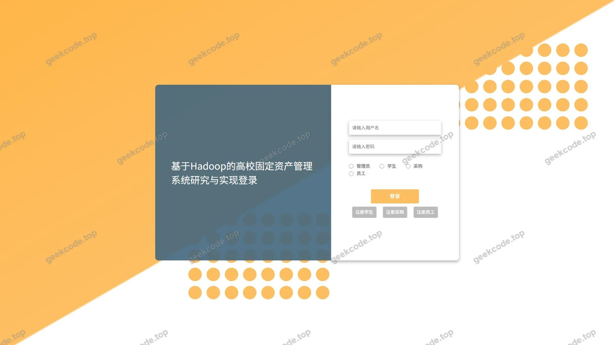</a>

<h4>后台-学生</h4>

<a href="https://geekcode.top/archives/%E5%9F%BA%E4%BA%8EHadoop%E7%9A%84%E9%AB%98%E6%A0%A1%E5%9B%BA%E5%AE%9A%E8%B5%84%E4%BA%A7%E7%AE%A1%E7%90%86%E7%B3%BB%E7%BB%9F%E7%A0%94%E7%A9%B6%E4%B8%8E%E5%AE%9E%E7%8E%B0hot14?utm_source=github" title="查看完整源码">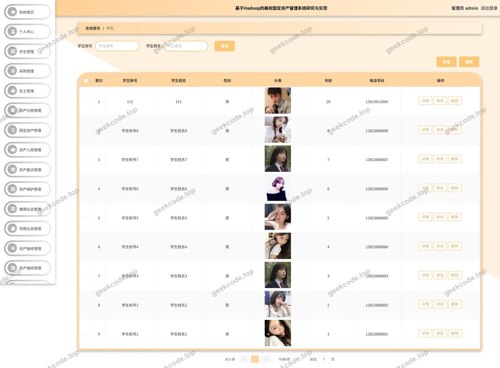</a>

<h4>后台-员工</h4>

<a href="https://geekcode.top/archives/%E5%9F%BA%E4%BA%8EHadoop%E7%9A%84%E9%AB%98%E6%A0%A1%E5%9B%BA%E5%AE%9A%E8%B5%84%E4%BA%A7%E7%AE%A1%E7%90%86%E7%B3%BB%E7%BB%9F%E7%A0%94%E7%A9%B6%E4%B8%8E%E5%AE%9E%E7%8E%B0hot14?utm_source=github" title="查看完整源码">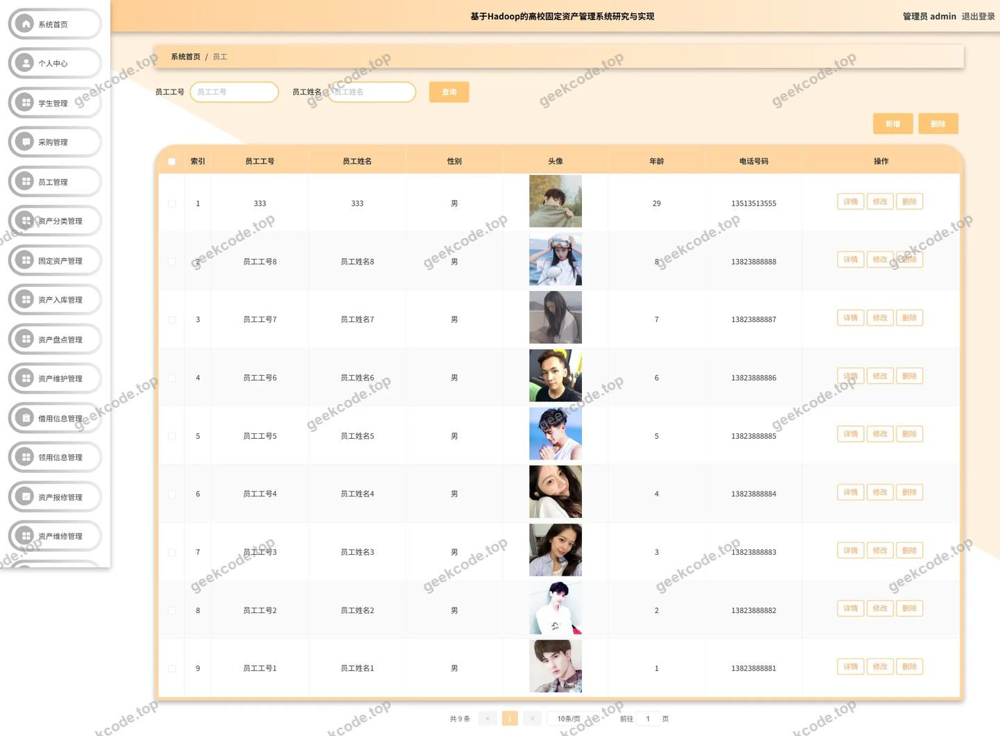</a>

<h4>后台-资产报废</h4>

<a href="https://geekcode.top/archives/%E5%9F%BA%E4%BA%8EHadoop%E7%9A%84%E9%AB%98%E6%A0%A1%E5%9B%BA%E5%AE%9A%E8%B5%84%E4%BA%A7%E7%AE%A1%E7%90%86%E7%B3%BB%E7%BB%9F%E7%A0%94%E7%A9%B6%E4%B8%8E%E5%AE%9E%E7%8E%B0hot14?utm_source=github" title="查看完整源码">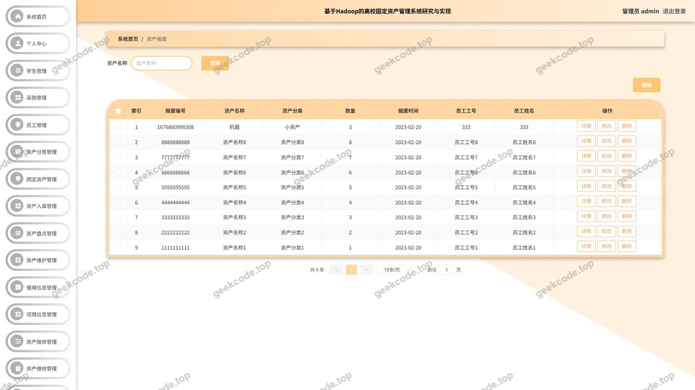</a>

<h4>后台-资产报修</h4>

<a href="https://geekcode.top/archives/%E5%9F%BA%E4%BA%8EHadoop%E7%9A%84%E9%AB%98%E6%A0%A1%E5%9B%BA%E5%AE%9A%E8%B5%84%E4%BA%A7%E7%AE%A1%E7%90%86%E7%B3%BB%E7%BB%9F%E7%A0%94%E7%A9%B6%E4%B8%8E%E5%AE%9E%E7%8E%B0hot14?utm_source=github" title="查看完整源码">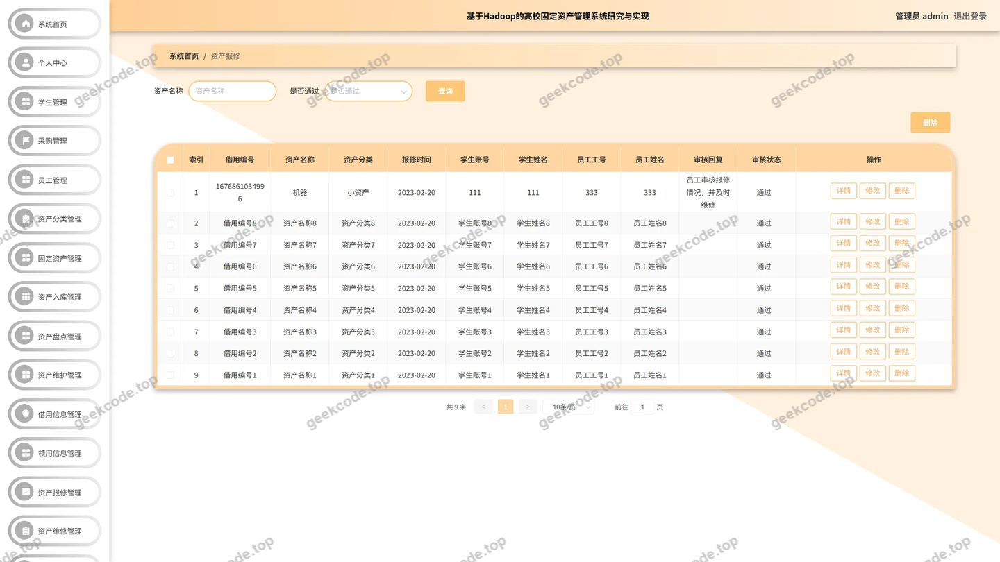</a>

<h4>后台-资产采购</h4>

<h4>后台-资产调拨</h4>

<h4>后台-资产分类</h4>

<a href="https://geekcode.top/archives/%E5%9F%BA%E4%BA%8EHadoop%E7%9A%84%E9%AB%98%E6%A0%A1%E5%9B%BA%E5%AE%9A%E8%B5%84%E4%BA%A7%E7%AE%A1%E7%90%86%E7%B3%BB%E7%BB%9F%E7%A0%94%E7%A9%B6%E4%B8%8E%E5%AE%9E%E7%8E%B0hot14?utm_source=github" title="查看完整源码">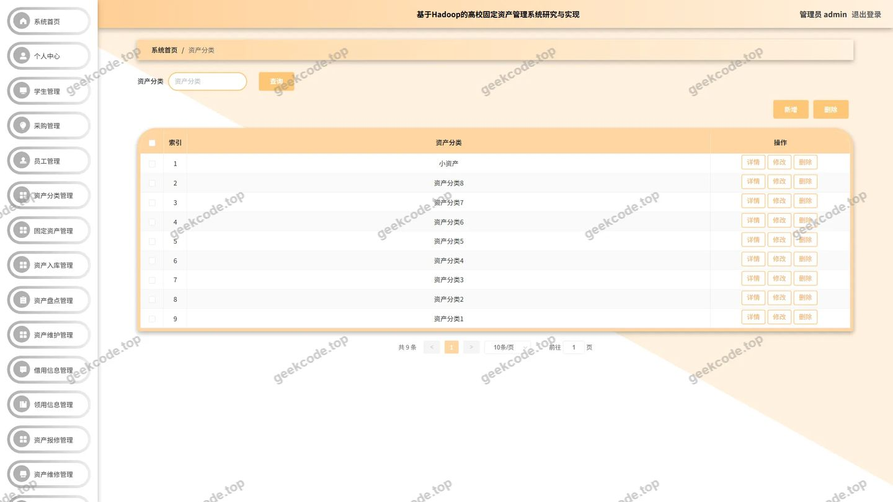</a>

<h4>后台-资产盘点</h4>

<h4>后台-资产入库</h4>

<h4>后台-资产维护</h4>

<a href="https://geekcode.top/archives/%E5%9F%BA%E4%BA%8EHadoop%E7%9A%84%E9%AB%98%E6%A0%A1%E5%9B%BA%E5%AE%9A%E8%B5%84%E4%BA%A7%E7%AE%A1%E7%90%86%E7%B3%BB%E7%BB%9F%E7%A0%94%E7%A9%B6%E4%B8%8E%E5%AE%9E%E7%8E%B0hot14?utm_source=github" title="查看完整源码">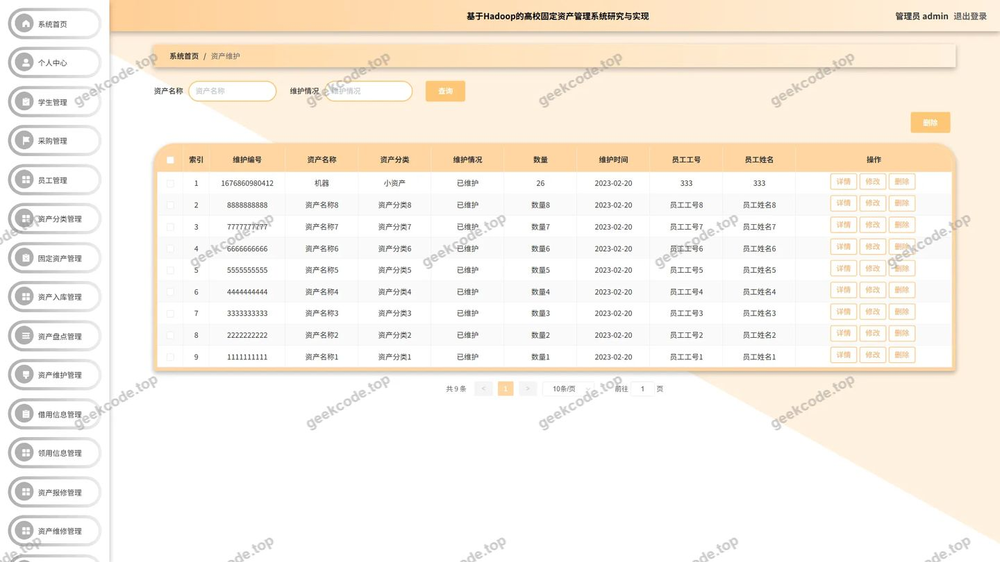</a>

<h4>后台-资产维修</h4>

<a href="https://geekcode.top/archives/%E5%9F%BA%E4%BA%8EHadoop%E7%9A%84%E9%AB%98%E6%A0%A1%E5%9B%BA%E5%AE%9A%E8%B5%84%E4%BA%A7%E7%AE%A1%E7%90%86%E7%B3%BB%E7%BB%9F%E7%A0%94%E7%A9%B6%E4%B8%8E%E5%AE%9E%E7%8E%B0hot14?utm_source=github" title="查看完整源码">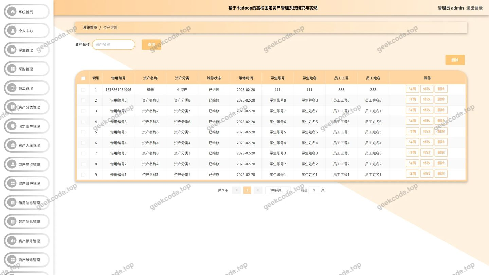</a>

---

## 获取完整源码

| 项目 | 说明 |
| --- | --- |
| 项目名 | 基于Hadoop的高校固定资产管理系统研究与实现hot14 |
| 运行截图 | 本文 17 张（站点带水印原图，仓库 `images/` 目录） |
| 完整源码 | [https://geekcode.top/archives/%E5%9F%BA%E4%BA%8EHadoop%E7%9A%84%E9%AB%98%E6%A0%A1%E5%9B%BA%E5%AE%9A%E8%B5%84%E4%BA%A7%E7%AE%A1%E7%90%86%E7%B3%BB%E7%BB%9F%E7%A0%94%E7%A9%B6%E4%B8%8E%E5%AE%9E%E7%8E%B0hot14?utm_source=github](https://geekcode.top/archives/%E5%9F%BA%E4%BA%8EHadoop%E7%9A%84%E9%AB%98%E6%A0%A1%E5%9B%BA%E5%AE%9A%E8%B5%84%E4%BA%A7%E7%AE%A1%E7%90%86%E7%B3%BB%E7%BB%9F%E7%A0%94%E7%A9%B6%E4%B8%8E%E5%AE%9E%E7%8E%B0hot14?utm_source=github) |
| 咨询微信 | **ir9372**（备注：jingpin-yuanma） |
| 更多项目 | [极客代码 geekcode.top](https://geekcode.top/?utm_source=github) |

> 需要源码、部署、改配置、跑不起来等问题，加微信 ir9372 沟通，说明项目名即可。
